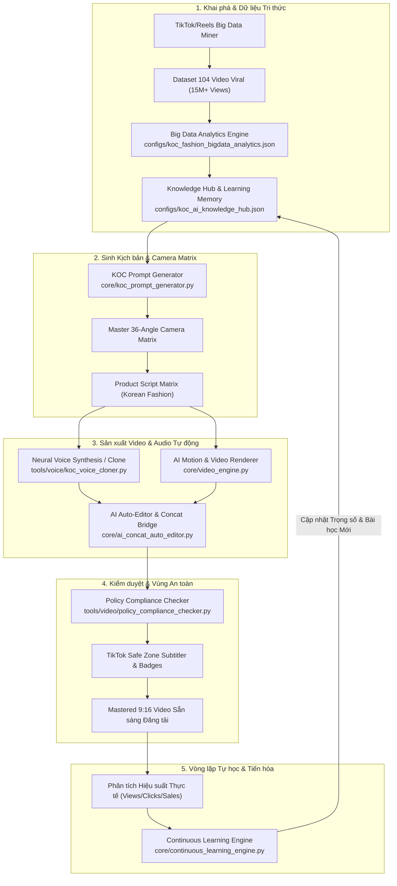

# 🌟 GOBI SOCIAL: Autonomous AI KOC & Social Media Intelligence System
> **Hệ sinh thái Tri thức & Tự động hóa KOC AI Đa kênh (TikTok Shop / Facebook Reels / YouTube Shorts)**

[](https://www.python.org/downloads/)
[](configs/koc_ai_knowledge_hub.json)
[](src/gobi/domain/policy_compliance_checker.py)
[](assets/koc_dna/MASTER_GOBI_OFFICIAL.jpg)

---

## 📖 MỤC LỤC (TABLE OF CONTENTS)
1. [Tổng quan hệ thống (System Overview)](#-tổng-quan-hệ-thống-system-overview)
2. [Kiến trúc luồng xử lý (Architecture Workflow)](#-kiến-trúc-luồng-xử-lý-architecture-workflow)
3. [Trung tâm Tri thức & Big Data (Knowledge Hub & Data)](#-trung-tâm-tri-thức--big-data-knowledge-hub--data)
4. [Định danh Nhân vật Master DNA (Character Master DNA)](#-định-danh-nhân-vật-master-dna-character-master-dna)
5. [Động cơ Cốt lõi (Autonomous Intelligence Engines)](#-động-cơ-cốt-lõi-autonomous-intelligence-engines)
6. [Công cụ Quét Chính sách & Voice Cloner (Tools & Compliance)](#-công-cụ-quét-chính-sách--voice-cloner-tools--compliance)
7. [Nhật ký Phiên làm việc & Sổ cái Tri thức (Session Logs)](#-nhật-ký-phiên-làm-việc--sổ-cái-tri-thức-session-logs)
8. [Quy chuẩn Vận hành Kiên trì Tuyệt đối (Relentless Execution)](#-quy-chuẩn-vận-hành-kiên-trì-tuyệt-đối-relentless-execution)
9. [Hướng dẫn Khởi chạy Nhanh (Quick Start Guide)](#-hướng-dẫn-khởi-chạy-nhanh-quick-start-guide)

---

## 🚀 TỔNG QUAN HỆ THỐNG (SYSTEM OVERVIEW)

**Gobi Social** là hệ thống toàn diện đóng gói toàn bộ tri thức, dữ liệu khai phá Big Data, công thức kịch bản viral, động cơ tự học tiến hóa liên tục và pipeline sản xuất video/voice tự động cho nhân vật **KOC AI Gô Bi (Gobi Thúi)**.

Hệ thống giải quyết triệt để các bài toán lớn nhất của Video AI Social Commerce:
* **Tính nhất quán khuôn mặt & thần thái (Character Consistency):** Khóa cứng DNA nhân vật qua bộ neo thị giác 36 góc quay (`assets/koc_dna/MASTER_GOBI_OFFICIAL.jpg` & `assets/koc_dna/GOBI_36_PANELS_OFFICIAL.jpg`).
* **Chuẩn hóa vùng an toàn TikTok (TikTok Safe Zone 9:16):** Tự động căn chỉnh padding, phụ đề, sticker giỏ hàng không bị thanh điều hướng và avatar che khuất.
* **Tự động quét vi phạm chính sách (AIGC & Policy Compliance):** Bộ từ điển cấm thời gian thực ngăn chặn triệt để nguy cơ bị bóp tương tác hoặc cấm kênh.
* **Tự học và tiến hóa liên tục (Continuous Learning):** Tự động phân tích chỉ số video thực tế (views, completion rate, GMV) để tối ưu trọng số câu lệnh và trích xuất bài học kinh nghiệm.

---

## 🏗️ KIẾN TRÚC LUỒNG XỬ LÝ (ARCHITECTURE WORKFLOW)



---

## 🧠 TRUNG TÂM TRI THỨC & BIG DATA (KNOWLEDGE HUB & DATA)

Hệ thống lưu trữ toàn bộ tri thức và dữ liệu khai phá tại thư mục `configs/` và `research_data/`:

| Tệp cấu hình / Dữ liệu | Mô tả chi tiết chức năng |
| :--- | :--- |
| **`configs/koc_ai_knowledge_hub.json`** | Trung tâm tri thức đầu não: Persona nhân vật Gô Bi, bộ quy tắc Safe Zone TikTok (padding 180px top, 320px bottom), từ điển cấm AIGC, ma trận 36 góc quay và trọng số prompt. |
| **`configs/koc_learning_memory.json`** | Sổ cái lưu vết tự học: Các bài học rút ra từ chiến dịch thực tế, lịch sử điều chỉnh trọng số prompt, phân tích nguyên nhân video thắng/thua. |
| **`configs/koc_fashion_bigdata_analytics.json`** | Bản phân tích chuyên sâu 104 video thời trang triệu view: Tỷ lệ giữ chân 3s đầu, nhịp điệu cắt cảnh (1.8s - 2.5s), công thức hook và vị trí đặt nút kêu gọi hành động (CTA). |
| **`configs/koc_fashion_bigdata_harvest.json`** | Tập dữ liệu thô thu thập từ hơn 104 video thời trang thành công (hơn 15 triệu lượt xem) với đầy đủ metadata, chỉ số tương tác và hashtag. |
| **`configs/koc_fashion_korean_products.json`** | Cơ sở dữ liệu sản phẩm thời trang phong cách Hàn Quốc: Thuộc tính chất liệu, form dáng, các góc quay review tối ưu cho từng mẫu váy áo. |
| **`configs/scenes_config.json`** | Cấu hình phân cảnh mẫu cho video review 45s (Hook -> Vấn đề -> Giải pháp -> Bằng chứng -> Kêu gọi hành động). |

---

## 👤 ĐỊNH DANH NHÂN VẬT MASTER DNA (CHARACTER MASTER DNA)

Nhân vật **Gô Bi (Gobi Thúi)** được chuẩn hóa ngoại hình và phong cách biểu cảm qua hệ thống hình ảnh neo thị giác:

* **`assets/koc_dna/MASTER_GOBI_OFFICIAL.jpg`**: Ảnh chân dung chuẩn (Master Anchor), khóa chặt cấu trúc khuôn mặt, ánh mắt, nụ cười và tông trang điểm.
* **`assets/koc_dna/GOBI_36_PANELS_OFFICIAL.jpg`**: Bảng tổng hợp 36 góc quay thực nghiệm (từ cận cảnh biểu cảm, góc nghiêng 3/4, góc từ trên xuống top-down, góc bước đi tự nhiên, đến cận cảnh chất vải).
* **`assets/datasets/koc/`**: Thư mục chứa toàn bộ 36 panel độc lập độ phân giải cao và manifest chi tiết phục vụ huấn luyện LoRA / Face-ID.

---

## ⚙️ ĐỘNG CƠ CỐT LÕI (AUTONOMOUS INTELLIGENCE ENGINES)

Thư mục `core/` bao gồm các động cơ xử lý độc lập:

1. **`src/gobi/services/intelligence/continuous_learning_engine.py`**:
   * Động cơ tự học và tối ưu hóa trọng số prompt theo phản hồi thực tế.
   * Tự động điều chỉnh các hệ số: `hook_strength`, `visual_clarity`, `audio_pacing`, `cta_urgency`.
   * Tự động bổ sung từ khóa vi phạm mới vào sổ cái tri thức.

2. **`src/gobi/services/prompt/koc_prompt_generator.py`**:
   * Trình sinh câu lệnh Prompt chuẩn điện ảnh 4K cho Veo / Midjourney / Flux.
   * Tự động gắn thẻ neo DNA nhân vật, góc máy trong ma trận 36 góc, phong cách ánh sáng soft studio và thông số Safe Zone.

3. **`src/gobi/services/media/ai_concat_auto_editor.py`**:
   * Tự động hóa quá trình dựng phim: Ghép các phân đoạn video ngắn theo nhịp nhạc, tạo hiệu ứng chuyển cảnh mềm mại (Ken Burns / Pan / Zoom).
   * Tự động chèn văn bản ghim trên (Header Hook) và phụ đề chuẩn Safe Zone.

4. **`src/gobi/services/media/video_engine.py` & `src/gobi/services/media/render_gobi_boutique_v1.py`**:
   * Bộ render video độ phân giải dọc 1080x1920 (9:16), 30fps.
   * Hỗ trợ ducking âm thanh thông minh (tự động giảm âm lượng nhạc nền BGM khi có giọng thuyết minh).

5. **`src/gobi/services/voice/generate_gobi_voice.py` & `src/gobi/services/voice/generate_gobi_trousers_voice.py`**:
   * Module tổng hợp giọng đọc tiếng Việt truyền cảm (Edge-TTS giọng Hoài My kết hợp xử lý cân bằng âm sắc EQ).

---

## 🛡️ CÔNG CỤ QUÉT CHÍNH SÁCH & VOICE CLONER (TOOLS & COMPLIANCE)

* **`src/gobi/domain/policy_compliance_checker.py`**:
  * Quét tự động kịch bản và phụ đề trước khi render.
  * Đối soát với danh mục từ khóa cấm của TikTok Shop (cam kết tuyệt đối, từ ngữ y tế thổi phồng, từ ngữ so sánh nhất, điều hướng nền tảng ngoài...).
* **`src/gobi/services/voice/koc_voice_cloner.py`**:
  * Pipeline nhân bản giọng nói thật từ video ngắn: Tự động tách vocal, khử tạp âm, cắt mẫu 4s-15s tinh khiết và đồng bộ ngữ điệu.
* **`integrations/agent_reach/`**:
  * Hệ thống Agent Reach tích hợp đa nền tảng (TikTok, YouTube, Facebook, Reddit, XHS) phục vụ nghiên cứu xu hướng và tự động tương tác.

---

## 📚 NHẬT KÝ PHIÊN LÀM VIỆC & SỔ CÁI TRI THỨC (SESSION LOGS)

Toàn bộ quá trình hình thành hệ sinh thái được ghi nhận minh bạch tại `conversation/SESSION_INDEX.md`:

| Phiên | Nội dung trọng tâm đã hoàn thành |
| :--- | :--- |
| **SESS-001** | Định vị kênh TikTok Affiliate `@tis.decor` & Chân dung khách hàng mục tiêu. |
| **SESS-002** | Xây dựng KOC AI Master DNA & Thiết lập Ma trận 36 góc quay chuẩn hóa. |
| **SESS-003** | Khởi tạo pipeline tổng hợp & clone giọng nói tiếng Việt tự nhiên. |
| **SESS-004** | Xây dựng Video Engine tự động ghép cảnh, chuyển cảnh Ken Burns & chèn phụ đề. |
| **SESS-005** | Tự động hóa Browser đăng nhập TikTok qua CDP & xác thực OAuth an toàn. |
| **SESS-006** | Xây dựng bảng điều khiển giám sát trực quan `live_viewer.html`. |
| **SESS-007** | Khai phá Big Data thời trang & Hoàn thiện Động cơ tự học Continuous Learning. |
| **SESS-008** | Chuẩn hóa quy chuẩn vận hành kiên trì tuyệt đối (`AGENTS.md` / `GEMINI.md`). |
| **SESS-009** | Tích hợp hệ thống Job Search & Multi-Channel Reach (`integrations/agent_reach/`). |
| **SESS-010** | Đồng nhất kiến trúc tài liệu và thư mục tri thức `conversation/`. |
| **SESS-011** | Khai phá 104 video triệu view, tối ưu Auto-Editor & Render video Gô Bi 9s. |
| **SESS-012** | Khóa DNA Master KOC, ma trận góc quay & Render video mẫu Gobi Thúi 9s. |
| **SESS-013** | Phân tích các ngách Video AI kiếm tiền từ view & Kế hoạch hệ sinh thái đa kênh. |
| **SESS-014** | Phân tích video TikTok AI Native Lab (Studio Claude 6 Skill) & Đề xuất ứng dụng. |
| **SESS-015** | Nhân bản giọng nói thật từ video mẫu & Tự động hóa Pipeline Voice Clone TikTok KOC. |
| **SESS-016** | Sản xuất Video KOC Review Áo Cardigan 45s (Mở miệng nói tiếng Việt & Safe Zone). |

---

## ⚡ QUY CHUẨN VẬN HÀNH KIÊN TRÌ TUYỆT ĐỐI (RELENTLESS EXECUTION)

Dự án tuân thủ nghiêm ngặt **Quy tắc Vận hành Tối cao** được định nghĩa trong `AGENTS.md`:
* **Mặc định hành động đến cùng:** Không bỏ cuộc trước bất kỳ trở ngại nào (lỗi DOM, selector, timeout, mã Captcha hay chống bot).
* **Vòng lặp chuyển đổi 5 cấp độ (Multi-Strategy Pivot Loop):**
  1. *Cấp 1:* Direct Selector (Semantic, ARIA, Data attributes).
  2. *Cấp 2:* DOM Traversal & JavaScript Evaluation (`page.evaluate()`).
  3. *Cấp 3:* Input & Bounding Box Mouse Simulation.
  4. *Cấp 4:* Headed Mode & Profile Chống phát hiện Bot.
  5. *Cấp 5:* Chrome DevTools Protocol (CDP) & Trực tiếp kế thừa phiên người dùng.
* **Bằng chứng xác thực (Proof-of-Work):** Tác vụ chỉ kết thúc khi có hình ảnh minh chứng hoặc video thành phẩm được kiểm tra hợp lệ.

---

## 🛠️ HƯỚNG DẪN KHỞI CHẠY NHANH (QUICK START GUIDE)

### 1. Cài đặt môi trường
```bash
git clone https://github.com/vmaxmartis09/gobi-social.git
cd gobi-social
pip install -r requirements.txt
```

### 2. Thiết lập biến môi trường
Tạo file `.env` từ file mẫu:
```bash
copy .env.example .env
```
*(Điền API keys của Gemini hoặc dịch vụ liên quan vào file `.env`)*

### 3. Kiểm tra vi phạm chính sách kịch bản (Policy Compliance Check)
```bash
python src/gobi/domain/policy_compliance_checker.py --script "Set đồ này mặc bao xinh, giá chỉ 139k mua ngay tại giỏ hàng!"
```

### 4. Sinh Prompt KOC chuẩn 36 góc quay
```bash
python src/gobi/services/prompt/koc_prompt_generator.py
```

### 5. Render Video Review Gobi Boutique 9:16
```bash
python src/gobi/services/media/render_gobi_boutique_v1.py
```

### 6. Khởi chạy Giao diện Giám sát Tự động hóa Trực quan
Mở trực tiếp tệp `live_viewer.html` trên trình duyệt để xem luồng chụp màn hình và trạng thái tự động hóa thời gian thực.

### 7. Tải Source Video TikTok Không Logo (SnapTik Module)
Tải source video MP4 sạch watermark, nhạc nền MP3, ảnh bìa và metadata vào project:
```bash
# Tải video sạch không logo vào output/videos/
./gobi snaptik "https://www.tiktok.com/@user/video/..."

# Tải kèm audio MP3 và ảnh bìa cover
./gobi snaptik "https://www.tiktok.com/@user/video/..." -a -c

# Xem thông số tương tác (views, likes, cmt, shares, duration) mà không tải
./gobi snaptik "https://www.tiktok.com/@user/video/..." -i

# Khởi chạy giao diện SnapTik Web UI trực quan (chuẩn phong cách snaptik.vn)
./gobi snaptik --web
```
Hoặc dùng trực tiếp trong Python:
```python
from gobi.services.media.snaptik_service import SnaptikService

service = SnaptikService()
result = service.download("https://www.tiktok.com/@user/video/...", download_audio=True)
print(f"Video đã lưu tại: {result.video_path}")
```

---
*Gobi Social - Được thiết kế và vận hành bởi đội ngũ AI Engineering & KOC Automation.*
