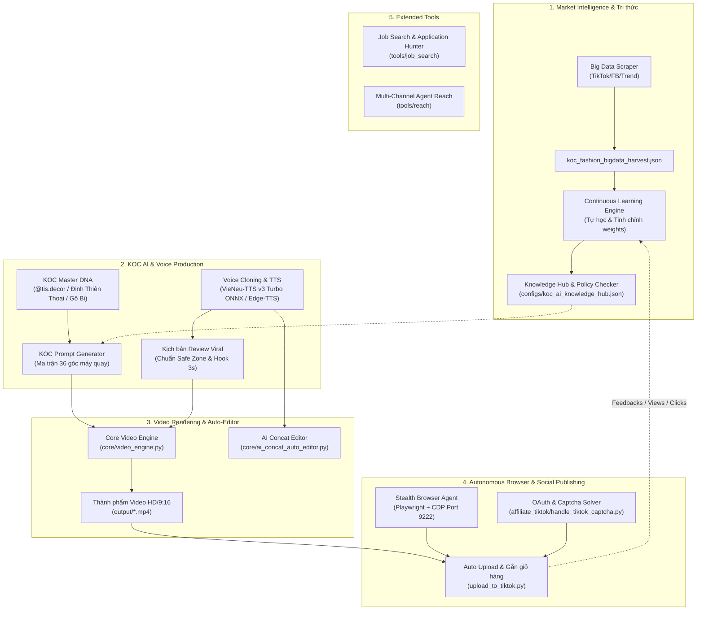

# 🌌 VMAX SYSTEM - BẢN ĐỒ TỔNG THỂ & ĐỒNG NHẤT HỆ THỐNG
> **Unified Knowledge & Conversation Hub**  
> *Thư mục này được thiết kế để tóm gọn, xâu chuỗi và đồng nhất toàn bộ các cuộc hội thoại, phân hệ chức năng và mục đích của VMAX thành một bức tranh toàn cảnh duy nhất.*

---

## 🗺️ 1. BỨC TRANH TỔNG THỂ (VMAX UNIFIED BLUEPRINT)

Hệ thống **VMAX** là một nền tảng tự động hóa khép kín (End-to-End Autonomous Platform), kết hợp giữa **Trí tuệ nhân tạo (AI)**, **Xử lý đa phương tiện (Video/Voice)** và **Tự động hóa trình duyệt (Browser Agent)** nhằm vận hành cỗ máy tiếp thị liên kết (TikTok Shop Affiliate) và nghiên cứu thị trường.



---

## 📂 2. CẤU TRÚC THƯ MỤC `conversation/`

Để tránh việc các cuộc hội thoại bị rời rạc, thư mục này được phân bổ chuẩn mực:

```text
conversation/
├── README.md                      # [Bạn đang xem] Bức tranh tổng thể và kiến trúc VMAX
├── SESSION_INDEX.md               # Sổ cái tổng hợp các phiên hội thoại (Log, ID, trạng thái)
├── TEMPLATE_CONVERSATION_LOG.md   # File mẫu để tóm tắt nhanh mọi cuộc hội thoại mới
└── topics/                        # Tài liệu tổng hợp theo từng nhánh chuyên đề:
    ├── 01_koc_ai_and_voice.md     # KOC ảo, DNA nhân vật, Prompt 36 góc, Voice clone
    ├── 02_video_production.md     # Biên tập, cắt ghép, render video, safe zone TikTok
    ├── 03_tiktok_automation.md    # Trình duyệt tàng hình, giải Captcha, đăng video, giỏ hàng
    ├── 04_learning_and_data.md    # Big data thời trang, tri thức AIGC, tự học tiến hóa
    └── 05_extended_tools.md       # Phân hệ Job Hunter và Outreach đa kênh
```

---

## 🧭 3. MA TRẬN PHÂN HỆ VÀ LIÊN KẾT MÃ NGUỒN

| Nhóm chức năng | Mục tiêu cốt lõi | File mã nguồn / Config chính | Trạng thái |
| :--- | :--- | :--- | :--- |
| **1. KOC AI & Voice** | Tạo nhân vật KOC nhất quán, clone giọng người thật offline | [`core/koc_ai_engine.py`](file:///c:/Users/HAI/OneDrive/Tài%20liệu/vmax/core/koc_ai_engine.py)<br>[`core/koc_prompt_generator.py`](file:///c:/Users/HAI/OneDrive/Tài%20liệu/vmax/core/koc_prompt_generator.py)<br>[`tools/voice/koc_voice_cloner.py`](file:///c:/Users/HAI/OneDrive/Tài%20liệu/vmax/tools/voice/koc_voice_cloner.py)<br>[`clone_voice_from_video.py`](file:///c:/Users/HAI/OneDrive/Tài%20liệu/vmax/clone_voice_from_video.py) | ✅ Đã khóa DNA, Ma trận 36 góc & Pipeline Voice Clone 48kHz (-14 LUFS) |
| **2. Video Engine** | Ghép nối scene, chèn phụ đề, căn chỉnh Safe Zone TikTok | [`core/video_engine.py`](file:///c:/Users/HAI/OneDrive/Tài%20liệu/vmax/core/video_engine.py)<br>[`core/ai_concat_auto_editor.py`](file:///c:/Users/HAI/OneDrive/Tài%20liệu/vmax/core/ai_concat_auto_editor.py)<br>[`render_full_video.py`](file:///c:/Users/HAI/OneDrive/Tài%20liệu/vmax/render_full_video.py) | ✅ Render 1080x1920 (4 Preset Concat triệu view, Safe Zone) |
| **3. Browser Bot** | Điều khiển trình duyệt qua CDP, vượt Captcha, upload TikTok & Flow Studio | [`affiliate_tiktok/full_verified_login.py`](file:///c:/Users/HAI/OneDrive/Tài%20liệu/vmax/affiliate_tiktok/full_verified_login.py)<br>[`affiliate_tiktok/handle_tiktok_captcha.py`](file:///c:/Users/HAI/OneDrive/Tài%20liệu/vmax/affiliate_tiktok/handle_tiktok_captcha.py)<br>[`upload_to_tiktok.py`](file:///c:/Users/HAI/OneDrive/Tài%20liệu/vmax/upload_to_tiktok.py)<br>[`launch_flow_studio.py`](file:///c:/Users/HAI/OneDrive/Tài%20liệu/vmax/launch_flow_studio.py) | ✅ Profile kết nối trực tiếp, có Live Viewer, tích hợp Flow Studio |
| **4. Tự học & Data** | Khai phá sản phẩm viral, tránh vi phạm chính sách | [`core/continuous_learning_engine.py`](file:///c:/Users/HAI/OneDrive/Tài%20liệu/vmax/core/continuous_learning_engine.py)<br>[`configs/koc_ai_knowledge_hub.json`](file:///c:/Users/HAI/OneDrive/Tài%20liệu/vmax/configs/koc_ai_knowledge_hub.json)<br>[`tools/video/policy_compliance_checker.py`](file:///c:/Users/HAI/OneDrive/Tài%20liệu/vmax/tools/video/policy_compliance_checker.py) | ✅ Kiểm soát từ cấm & 11 bài học kinh nghiệm |
| **5. Công cụ ngoài** | Tìm việc tự động & tiếp cận mạng xã hội | [`tools/job_search/`](file:///c:/Users/HAI/OneDrive/Tài%20liệu/vmax/tools/job_search)<br>[`tools/reach/`](file:///c:/Users/HAI/OneDrive/Tài%20liệu/vmax/tools/reach) | ✅ Sẵn sàng |

---

## 📌 4. HƯỚNG DẪN DUY TRÌ TÍNH ĐỒNG NHẤT
Mỗi khi kết thúc một cuộc hội thoại mới với AI (hoặc giải quyết xong một đầu việc lớn):
1. **Ghi nhận vào log:** Tạo 1 file trong `conversation/sessions/` theo mẫu [`TEMPLATE_CONVERSATION_LOG.md`](file:///c:/Users/HAI/OneDrive/Tài%20liệu/vmax/conversation/TEMPLATE_CONVERSATION_LOG.md).
2. **Cập nhật trạng thái:** Điền dòng mới vào [`SESSION_INDEX.md`](file:///c:/Users/HAI/OneDrive/Tài%20liệu/vmax/conversation/SESSION_INDEX.md).
3. **Cập nhật tri thức:** Nếu cuộc hội thoại mang lại bài học kỹ thuật mới, đồng bộ ngay vào topic tương ứng trong `conversation/topics/`.
