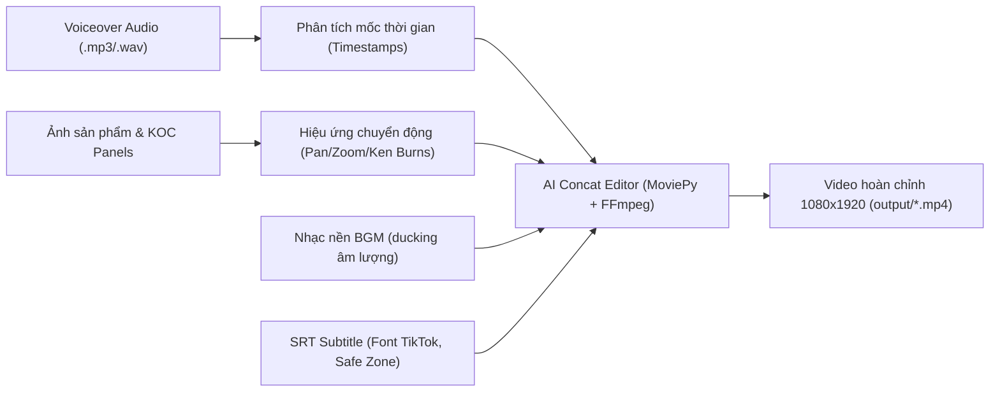

# 🎬 TOPIC 02: VIDEO PRODUCTION & AUTO-EDITOR PIPELINE
> **Tổng hợp chuyên đề:** Kiến trúc Render video tự động, ghép phân cảnh theo nhịp audio, chèn phụ đề tự động và chuẩn hóa Safe Zone TikTok.

---

## 1. MỤC ĐÍCH & Ý NGHĨA TRONG BỨC TRANH VMAX
* Biến chuỗi ảnh/video raw và audio voiceover thành một video ngắn hoàn chỉnh (1080x1920 dọc 9:16) sẵn sàng đăng tải TikTok.
* Tự động đồng bộ hóa thời lượng hiển thị hình ảnh khớp từng micro-giây với câu thoại của KOC.
* Đảm bảo phụ đề, logo và nhãn dán không bao giờ bị các nút chức năng của TikTok (Tim, Bình luận, Giỏ hàng góc trái) che khuất.

---

## 2. KIẾN TRÚC XỬ LÝ VIDEO

---

## 3. CÁC THÀNH PHẦN KỸ THUẬT

### 3.1. Core Video Engine
* File mã nguồn: [`core/video_engine.py`](file:///c:/Users/HAI/OneDrive/Tài%20liệu/vmax/core/video_engine.py)
* Dựa trên nền tảng `MoviePy (2.2.1)` kết hợp `imageio-ffmpeg`.
* Hỗ trợ chèn overlay, xử lý âm thanh đa luồng (Voice chính + Nhạc nền có ducking tự động hạ âm khi có tiếng nói).

### 3.2. AI Concat Auto Editor & Bridge
* File mã nguồn: [`core/ai_concat_auto_editor.py`](file:///c:/Users/HAI/OneDrive/Tài%20liệu/vmax/core/ai_concat_auto_editor.py) và [`core/concat_bridge.py`](file:///c:/Users/HAI/OneDrive/Tài%20liệu/vmax/core/concat_bridge.py).
* Nhận cấu hình kịch bản phân cảnh từ `scenes_config.json`, tự động tính toán thời lượng từng scene dựa trên độ dài audio thực tế.
* Quản lý thư mục tạm [`temp_clips/`](file:///c:/Users/HAI/OneDrive/Tài%20liệu/vmax/temp_clips) để ghép nối mượt mà trước khi nén file cuối.

### 3.3. Quy chuẩn TikTok Safe Zone
* Vùng đỉnh (Top 15%): Tránh thanh tìm kiếm TikTok.
* Vùng đáy (Bottom 25%): Tránh phần hiển thị mô tả video, hashtag, tên bài hát và đặc biệt là **Nút Giỏ Hàng TikTok Shop** (Bottom-Left).
* Vùng cạnh phải (Right 15%): Tránh cột icon Tương tác (Avatar kênh, Nút Like, Comment, Bookmark, Share).
* Phụ đề luôn được canh giữa (Center-aligned) trong khoảng từ 60% đến 75% chiều cao màn hình.

---

## 4. CÁC FILE LIÊN QUAN CHÍNH
* [`render_full_video.py`](file:///c:/Users/HAI/OneDrive/Tài%20liệu/vmax/render_full_video.py)
* [`create_koc_video.py`](file:///c:/Users/HAI/OneDrive/Tài%20liệu/vmax/create_koc_video.py)
* [`polish_subtitles.py`](file:///c:/Users/HAI/OneDrive/Tài%20liệu/vmax/polish_subtitles.py)
* [`output/KOC_AI_Tai_Nghe_Viral_Review.mp4`](file:///c:/Users/HAI/OneDrive/Tài%20liệu/vmax/output)
