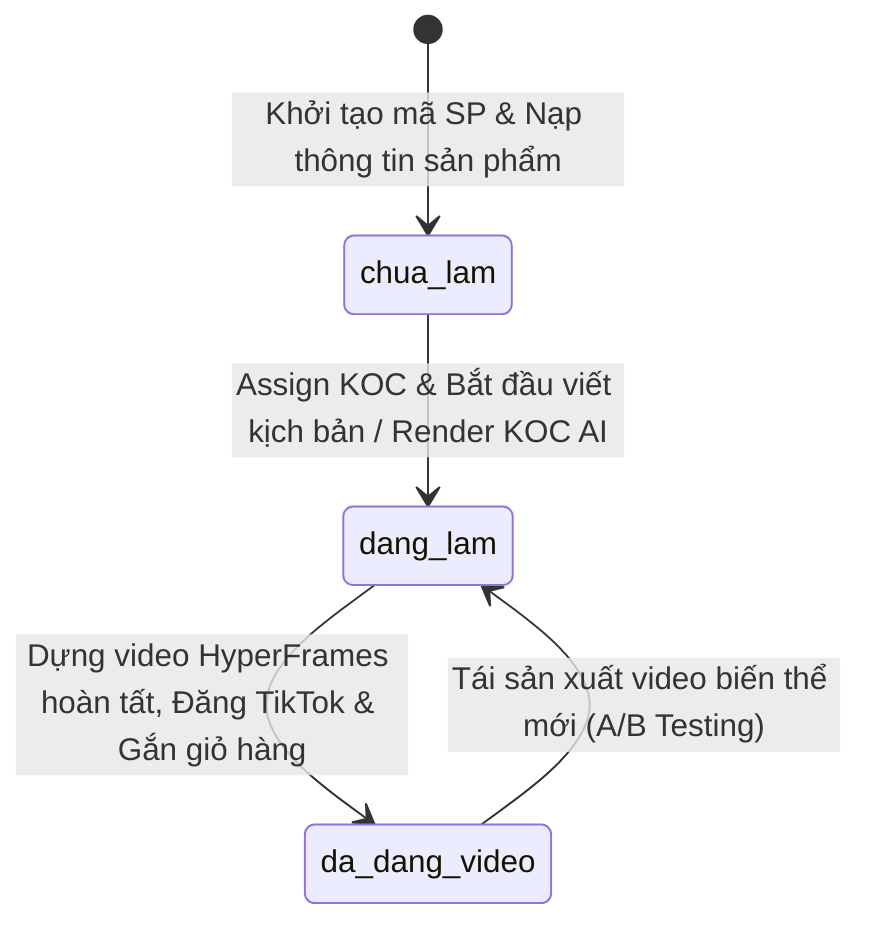

# 📦 TÀI LIỆU HỆ THỐNG QUẢN TRỊ KHO SẢN PHẨM KOC AI
# (GOBI SOCIAL PRODUCT WAREHOUSE & AUTOMATION SPECIFICATION)

> **Phiên bản:** 2.0.0 | **Cập nhật:** 2026-10-20  
> **Quản trị hệ thống:** Gobi Social Core Architecture  
> **Cơ sở dữ liệu:** `configs/products/warehouse_index.json` & `configs/products/catalog/`

---

## 🏛️ 1. TỔNG QUAN KIẾN TRÚC KHO SẢN PHẨM (WAREHOUSE ARCHITECTURE)

Kho sản phẩm Gobi Social được thiết kế theo mô hình **Folder-per-Product (Một sản phẩm = Một thư mục độc lập)**, đảm bảo dữ liệu sản phẩm, kịch bản video, bộ từ khóa SEO và tài nguyên media (ảnh, video benchmark) được đóng gói tập trung, không phân mảnh.

### 1.1. Cấu Trúc Thư Mục Chuẩn Hóa
```text
configs/products/
├── warehouse_index.json              # [SỔ CÁI TRUNG TÂM] Chỉ mục tìm kiếm siêu tốc O(1)
├── tiktok_products_pipeline.json     # Cấu hình chiến dịch Affiliate TikTok Shop
└── catalog/                          # [KHO SẢN PHẨM] Thư mục chứa từng mã sản phẩm
    ├── SP-BJ-001/                    # Mã sản phẩm độc nhất
    │   ├── product_info.json         # Toàn bộ thông số kỹ thuật, giá, hoa hồng, status, KOC
    │   ├── koc_script.md             # Kịch bản sản xuất KOC AI phân cảnh
    │   ├── seo_metadata.json         # Bộ từ khóa SEO TikTok khép kín, caption, hashtag
    │   └── assets/                   # Ảnh mẫu sản phẩm, thớ vải, cover video
    │       └── cover.jpg
    ├── SP-QT-002/
    ├── SP-QJ-003/
    ├── SP-QS-004/
    ├── SP-CD-005/
    ├── SP-VB-006/
    └── SP-TX-007/
```

### 1.2. Quy Chuẩn Vòng Đời Trạng Thái (Status Lifecycle)
Mỗi sản phẩm trong kho vận hành theo 3 trạng thái nghiêm ngặt:



1. **`chua_lam` (Chưa làm):** Sản phẩm đã có đầy đủ thông tin nguồn hàng, giá bán, hoa hồng và ý tưởng phân cảnh, sẵn sàng đưa vào lịch sản xuất.
2. **`dang_lam` (Đang làm):** Sản phẩm đang trong chu trình sản xuất (viết prompt camera Kling 3.0 / Veo 3.1, clone giọng đọc VieNeu-TTS / OmniVoice hoặc dựng timeline HyperFrames).
3. **`da_dang_video` (Đã đăng video):** Video đã render hoàn thiện độ phân giải 1080x1920 60fps, xuất bản thành công lên kênh TikTok của KOC được phân công và gắn link giỏ hàng TikTok Shop Affiliate.

### 1.3. Hệ Thống Nhân Vật KOC AI Được Phân Công (Assigned KOCs)
* **`@gobiboutique` (KOC Gô Bi):** KOC chính thức kênh hạt nhân (21 tuổi, 1m62 - 48kg, gu Nàng thơ Hàn Quốc nhu mì, ngọt ngào, chuyên váy đầm, cardigan, quần tây hack dáng).
* **`@thienthoaireview` (Đinh Thiên Thoại):** KOC phong cách nam tính, review góc nhìn con trai về thời trang nữ và gợi ý quà tặng bạn gái.
* **`@gobi.aries` / `@gobi.taurus` (Chòm sao Zodiac Network):** KOC AI phong cách năng động, Y2K cá tính, streetwear dạo phố.

---

## 📊 2. BẢNG TỔNG HỢP DANH MỤC SẢN PHẨM (MASTER INVENTORY)

| Mã SP | Tên Sản Phẩm | Ngành Hàng | Giá Bán (đ) | Hoa Hồng | KOC Phụ Trách | Trạng Thái | Link Video / Benchmark |
| :--- | :--- | :--- | :---: | :---: | :--- | :---: | :--- |
| **SP-BJ-001** | Áo Thun Giấy Tay Dài Cổ Henley Byjane | Áo thun | 89.000 | 22% (19.580đ) | `@gobiboutique` | <span style="color:green">**ĐÃ ĐĂNG VIDEO**</span> | [TikTok 7678960622423330066](https://www.tiktok.com/@gobiboutique/video/7678960622423330066) *(378k views)* |
| **SP-QT-002** | Quần Tây Ống Suông Vải Tuyết Mưa Hack Dáng | Quần tây | 139.000 | 20% (27.800đ) | `@gobiboutique` | <span style="color:green">**ĐÃ ĐĂNG VIDEO**</span> | [TikTok 7697472862633921812](https://www.tiktok.com/@gobiboutique/video/7697472862633921812) *(2.6M views)* |
| **SP-QJ-003** | Quần Jean Nữ Ống Rộng Cạp Cao Retro | Quần jean | 159.000 | 18% (28.620đ) | `@gobi.aries` | <span style="color:orange">**ĐANG LÀM**</span> | Benchmark @hinthanh806 *(1.0M views)* |
| **SP-QS-004** | Quần Short Nắp Túi Cạp Trễ Y2K | Quần short | 99.000 | 20% (19.800đ) | `@gobi.taurus` | <span style="color:red">**CHƯA LÀM**</span> | Benchmark @lumystore6 *(488k views)* |
| **SP-CD-005** | Áo Khoác Cardigan Len Mỏng Dáng Rộng SuChang | Áo khoác | 129.000 | 20% (25.800đ) | `@gobiboutique` | <span style="color:orange">**ĐANG LÀM**</span> | Benchmark @suchangvn *(368k views)* |
| **SP-VB-006** | Váy Body Tay Dài Cổ Vuông Tôn Dáng LAVENDER | Váy đầm | 249.000 | 18% (44.820đ) | `@thienthoaireview` | <span style="color:red">**CHƯA LÀM**</span> | Chiến dịch AFF-01 (Kịch bản date) |
| **SP-TX-007** | Túi Xách Nữ Kẹp Nách Da Mềm Xích Bạc MOLLIX | Túi xách | 189.000 | 20% (37.800đ) | `@thienthoaireview` | <span style="color:red">**CHƯA LÀM**</span> | Chiến dịch AFF-02 (What's in my bag) |

---

## 📑 3. HỒ SƠ CHI TIẾT TỪNG SẢN PHẨM TRONG KHO (PRODUCT DATA SHEETS)

---

### 1. [SP-BJ-001] Áo Thun Giấy Tay Dài Cổ Henley Byjane Form Suông
* **Đường dẫn thư mục:** `configs/products/catalog/SP-BJ-001/`
* **Trạng thái:** `da_dang_video` (Đã đăng video) | **KOC phụ trách:** `@gobiboutique`
* **Shop cung ứng:** Byjane Official Store
* **Tài chính:** Giá niêm yết: **89.000đ** (Giá gốc: 149.000đ) | Hoa hồng: **22.0%** (19.580đ/đơn).
* **Thông số sản phẩm:**
  * **Chất liệu:** Thun giấy dệt xước (Slub Knit), mỏng nhẹ thoáng khí, sợi dệt đôi không nhăn khi giặt.
  * **Bảng màu:** Trắng kem (Off-white), Đen basic, Xám tiêu, Be sữa.
  * **Kích cỡ:** Freesize (40kg - 58kg).
  * **Điểm bán hàng (USP):**
    1. Cổ henley cài cúc linh hoạt, mở cúc khoe xương quai xanh thanh tú.
    2. Form suông rủ tự nhiên che khuyết điểm bắp tay to và eo bánh mì.
    3. Mỏng nhẹ bay bổng, mặc kèm bra màu nude sang trọng chuẩn style Clean Girl Hàn Quốc.
* **Kế hoạch Video & SEO:**
  * **Format video:** Tactile Proof & Save Magnet (1 Item 3 Outfits).
  * **Ma trận VMAX Panels:** Panel 03 (Cận mặt), Panel 14 (Cổ áo), Panel 25 (Thớ vải dệt xước), Panel 26 (Bước đi hack dáng), Panel 36 (Xoay người).
  * **Từ khóa chính SEO:** `áo thun giấy tay dài`, `áo thun byjane`, `áo thun giấy form rộng`.
  * **Video đã xuất bản:** [TikTok Link](https://www.tiktok.com/@gobiboutique/video/7678960622423330066)

---

### 2. [SP-QT-002] Quần Tây Ống Suông Lưng Cao Vải Tuyết Mưa Hack Dáng 1m7
* **Đường dẫn thư mục:** `configs/products/catalog/SP-QT-002/`
* **Trạng thái:** `da_dang_video` (Đã đăng video) | **KOC phụ trách:** `@gobiboutique`
* **Shop cung ứng:** Linh Beauty Fashion
* **Tài chính:** Giá niêm yết: **139.000đ** (Giá gốc: 219.000đ) | Hoa hồng: **20.0%** (27.800đ/đơn).
* **Thông số sản phẩm:**
  * **Chất liệu:** Vải tuyết mưa Vitex loại 1, đanh mịn, không xù lông, chống nhăn tối đa khi ngồi văn phòng/lớp học.
  * **Bảng màu:** Đen tuyền, Be kem Hàn Quốc, Nâu tây, Xám chì.
  * **Kích cỡ:** S (40-46kg), M (47-52kg), L (53-58kg), XL (59-64kg).
  * **Điểm bán hàng (USP):**
    1. Cạp cao trên rốn 5cm ôm phẳng lì bụng dưới.
    2. Ống suông thẳng đứng buông rủ chạm gót giày kéo dài tỷ lệ chân như 1m7.
    3. Hai túi chéo sâu tiện lợi đựng điện thoại mà không làm phồng hông.
* **Kế hoạch Video & SEO:**
  * **Format video:** Body Hack Visuals (Cạp cao giấu bụng + Kéo chân dài).
  * **Ma trận VMAX Panels:** Panel 01 (Toàn thân), Panel 14 (Trung cảnh eo), Panel 26 (Bước đi hack dáng).
  * **Từ khóa chính SEO:** `quần tây ống suông`, `quần tây cạp cao hack dáng`, `quần tây nữ đi học`.
  * **Video đã xuất bản:** [TikTok Link](https://www.tiktok.com/@gobiboutique/video/7697472862633921812) *(Benchmark đối thủ: 2.6M views)*

---

### 3. [SP-QJ-003] Quần Jean Nữ Ống Rộng Cạp Cao Vintage Retro Hàn Quốc
* **Đường dẫn thư mục:** `configs/products/catalog/SP-QJ-003/`
* **Trạng thái:** `dang_lam` (Đang làm kịch bản & render) | **KOC phụ trách:** `@gobi.aries`
* **Shop cung ứng:** Hin Thanh Denim Studio
* **Tài chính:** Giá niêm yết: **159.000đ** (Giá gốc: 250.000đ) | Hoa hồng: **18.0%** (28.620đ/đơn).
* **Thông số sản phẩm:**
  * **Chất liệu:** Denim cotton 100% 12oz dày dặn, wash màu vintage chống phai.
  * **Bảng màu:** Xanh retro nhạt, Xanh đậm vintage, Xám khói wash.
  * **Kích cỡ:** S, M, L.
  * **Điểm bán hàng (USP):**
    1. Form đứng đứng form, tôn vòng 3 đầy đặn, không xệ đáy.
    2. Độ dài chuẩn trùm gót giày sneaker hoặc cao gót.
    3. Phong cách Streetwear retro dễ phối cùng áo thun, croptop.
* **Kế hoạch Video & SEO:**
  * **Format video:** Shocking Comparison (Quần ôm dìm dáng vs Quần jean ống rộng).
  * **Ma trận VMAX Panels:** Panel 01 (Toàn thân), Panel 22 (Ngang hông), Panel 36 (Xoay người).
  * **Từ khóa chính SEO:** `quần jean ống rộng`, `quần jean nữ cạp cao`, `quần bò ống suông`.
  * **Benchmark đối thủ:** [TikTok 7679350378198060296](https://www.tiktok.com/@hinthanh806/video/7679350378198060296) *(1.0M views)*

---

### 4. [SP-QS-004] Quần Short Nắp Túi Cạp Trễ Tôn Dáng Y2K Năng Động
* **Đường dẫn thư mục:** `configs/products/catalog/SP-QS-004/`
* **Trạng thái:** `chua_lam` (Chưa làm) | **KOC phụ trách:** `@gobi.taurus`
* **Shop cung ứng:** Lumy Store Vietnam
* **Tài chính:** Giá niêm yết: **99.000đ** (Giá gốc: 160.000đ) | Hoa hồng: **20.0%** (19.800đ/đơn).
* **Thông số sản phẩm:**
  * **Chất liệu:** Kaki thun mềm co giãn nhẹ, giữ form nắp túi hộp sắc sảo.
  * **Bảng màu:** Xanh nhạt pastel, Xám khói, Đen basic, Trắng kem.
  * **Kích cỡ:** S, M, L.
  * **Điểm bán hàng (USP):**
    1. Thiết kế 2 nắp túi hộp tôn hông quả táo.
    2. Gấu may cuốn mép tinh tế, an toàn khi vận động.
    3. Phù hợp style Y2K dạo phố mùa hè.
* **Kế hoạch Video & SEO:**
  * **Format video:** Fast-Cut Beat Syncing (Cắt chuyển cảnh 1.5s theo nhịp beat).
  * **Ma trận VMAX Panels:** Panel 01 (Toàn thân), Panel 22 (Ngang hông), Panel 36 (Xoay người).
  * **Từ khóa chính SEO:** `quần short nữ`, `quần short nắp túi`, `quần short y2k`.
  * **Benchmark đối thủ:** [TikTok 7690007359501978900](https://www.tiktok.com/@lumystore6/video/7690007359501978900) *(488.9k views)*

---

### 5. [SP-CD-005] Áo Khoác Cardigan Len Mỏng Dáng Rộng Nàng Thơ SuChang
* **Đường dẫn thư mục:** `configs/products/catalog/SP-CD-005/`
* **Trạng thái:** `dang_lam` (Đang làm) | **KOC phụ trách:** `@gobiboutique`
* **Shop cung ứng:** SuChang Studio
* **Tài chính:** Giá niêm yết: **129.000đ** (Giá gốc: 199.000đ) | Hoa hồng: **20.0%** (25.800đ/đơn).
* **Thông số sản phẩm:**
  * **Chất liệu:** Len dệt kim mỏng nhẹ, sợi bông tự nhiên êm ái không gây châm chích.
  * **Bảng màu:** Be sữa, Nâu nhạt, Hồng pastel, Xanh bơ.
  * **Kích cỡ:** Freesize (dưới 60kg).
  * **Điểm bán hàng (USP):**
    1. Dệt lỏng tay tạo độ rủ mềm mại, nữ tính.
    2. Cúc áo ánh xà cừ phong cách vintage Hàn Quốc.
    3. Đa năng: làm áo khoác ngoài đầm 2 dây hoặc cài cúc mặc đơn lẻ.
* **Kế hoạch Video & SEO:**
  * **Format video:** Daily Vlog KOC & ASMR Fabric (Âm thanh sột soạt chạm thớ len).
  * **Ma trận VMAX Panels:** Panel 03 (Cận mặt), Panel 25 (Thớ len), Panel 26 (Toàn thân), Panel 02 (Chỉ giỏ hàng).
  * **Từ khóa chính SEO:** `áo cardigan len mỏng`, `áo khoác len nàng thơ`, `cardigan dáng rộng`.
  * **Benchmark đối thủ:** [TikTok 7680123456789012345](https://www.tiktok.com/@suchangvn/video/7680123456789012345) *(368.6k views)*

---

### 6. [SP-VB-006] Váy Body Tay Dài Cổ Vuông Tôn Dáng Phối Ren LAVENDER
* **Đường dẫn thư mục:** `configs/products/catalog/SP-VB-006/`
* **Trạng thái:** `chua_lam` (Chưa làm) | **KOC phụ trách:** `@thienthoaireview`
* **Shop cung ứng:** LAVENDER Official Store
* **Tài chính:** Giá niêm yết: **249.000đ** (Giá gốc: 380.000đ) | Hoa hồng: **18.0%** (44.820đ/đơn).
* **Thông số sản phẩm:**
  * **Chất liệu:** Thun tăm gân cao cấp co giãn 4 chiều, viền ren mi mềm mịn.
  * **Bảng màu:** Đen quyến rũ, Trắng tiểu thư, Đỏ rượu vang.
  * **Kích cỡ:** S (40-47kg), M (48-54kg).
  * **Điểm bán hàng (USP):**
    1. Cổ vuông sâu tôn xương quai xanh và vòng 1 thanh lịch.
    2. Rúm nhẹ hai bên hông che giấu bụng dưới hoàn hảo.
    3. Vải dày dặn không lo lộ viền đồ lót.
* **Kế hoạch Video & SEO:**
  * **Format video:** POV (Con trai chấm điểm đồ bạn gái mặc đi date).
  * **Ma trận VMAX Panels:** Panel 01 (Toàn thân), Panel 03 (Cận mặt), Panel 36 (Xoay dáng).
  * **Từ khóa chính SEO:** `váy body tay dài`, `đầm ôm cổ vuông`, `váy body tôn dáng`.

---

### 7. [SP-TX-007] Túi Xách Nữ Kẹp Nách Da Mềm Đính Dây Xích Bạc MOLLIX
* **Đường dẫn thư mục:** `configs/products/catalog/SP-TX-007/`
* **Trạng thái:** `chua_lam` (Chưa làm) | **KOC phụ trách:** `@thienthoaireview`
* **Shop cung ứng:** MOLLIX Studio
* **Tài chính:** Giá niêm yết: **189.000đ** (Giá gốc: 299.000đ) | Hoa hồng: **20.0%** (37.800đ/đơn).
* **Thông số sản phẩm:**
  * **Chất liệu:** Da PU chống xước bề mặt lì mịn, xích bạc tĩnh điện không gỉ.
  * **Bảng màu:** Đen sang trọng, Trắng kem, Bạc ánh kim metallic.
  * **Kích cỡ:** 24cm x 14cm x 7cm (đựng vừa iPhone Pro Max + son phấn).
  * **Điểm bán hàng (USP):**
    1. Kèm 2 dây quai tháo rời: biến đổi linh hoạt từ kẹp nách sang đeo chéo.
    2. Ngăn khóa zip an toàn, lót vải nhung chống trầy đồ dùng.
    3. Dây xích bạc làm điểm nhấn bắt sáng khi chụp ảnh dạo phố.
* **Kế hoạch Video & SEO:**
  * **Format video:** Unboxing & What's In My Bag (Đựng cả thế giới con gái).
  * **Ma trận VMAX Panels:** Panel 22 (Cận tay cầm túi), Panel 25 (Chất da & xích), Panel 01 (Lên đồ dạo phố).
  * **Từ khóa chính SEO:** `túi kẹp nách nữ`, `túi xách nữ da mềm`, `túi xách dây xích`.

---

## 🛠️ 4. HƯỚNG DẪN ĐIỀU HÀNH & LỆNH CLI TỰ ĐỘNG HÓA

Hệ thống cung cấp bộ công cụ CLI `python -m gobi warehouse` để tra cứu, cập nhật trạng thái và phân công KOC tự động:

### 4.1. Xem danh sách sản phẩm trong kho
```bash
# Xem toàn bộ kho
python -m gobi warehouse list

# Lọc theo trạng thái sản xuất (chua_lam / dang_lam / da_dang_video)
python -m gobi warehouse list --status dang_lam

# Lọc theo KOC AI phụ trách
python -m gobi warehouse list --koc @gobiboutique
```

### 4.2. Xem hồ sơ chi tiết của một sản phẩm
```bash
python -m gobi warehouse get SP-BJ-001
```

### 4.3. Cập nhật trạng thái sản xuất & Gắn link video
```bash
# Cập nhật sang ĐANG LÀM
python -m gobi warehouse update-status SP-QS-004 dang_lam

# Cập nhật sang ĐÃ ĐĂNG VIDEO và gán URL TikTok
python -m gobi warehouse update-status SP-QJ-003 da_dang_video --video-url "https://www.tiktok.com/@gobi.aries/video/7699999999999999999"
```

### 4.4. Phân công hoặc Đổi KOC AI phụ trách
```bash
python -m gobi warehouse assign SP-TX-007 @gobiboutique
```

### 4.5. Tái tạo lại sổ cái chỉ mục (Rebuild Index)
```bash
python -m gobi warehouse rebuild
```
